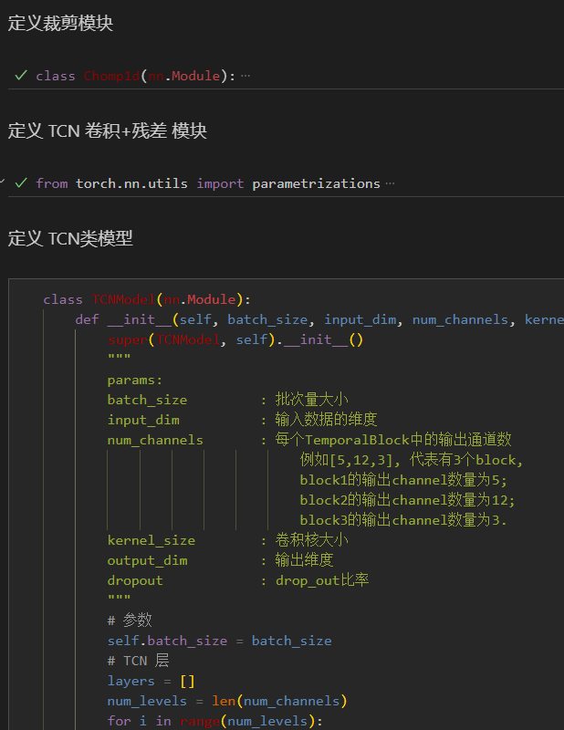
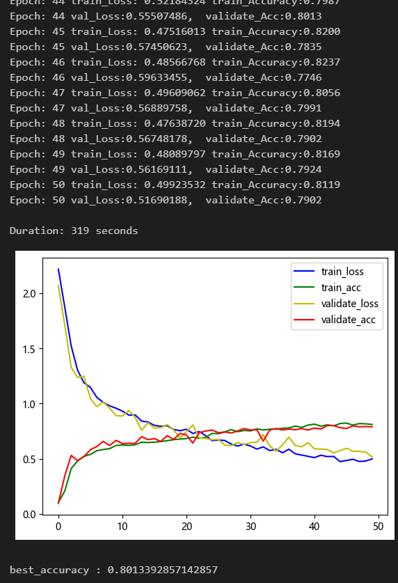
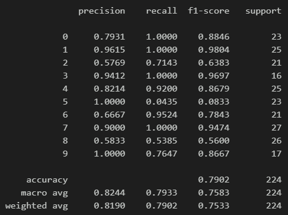
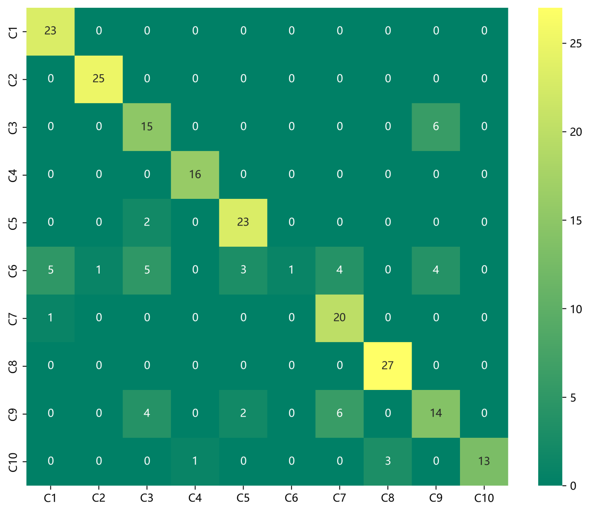
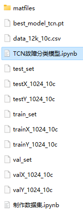

# Bearing Fault Diagnosis - TCN Fault Classification Model

Including the complete CWRU bearing fault dataset, as well as the fault signal dataset, classification data, and label set that have been generated and ready for use.
50 epochs, accuracy of 80%, the classification effect of TCN network is remarkable. The model can fully extract spatial and temporal features as well as frequency domain features of bearing fault signals, with fast convergence speed and superior performance, high precision. Innovation also exists!!!
Includes code for data preprocessing and TCN classification.
Environment: Python 3.9, PyTorch 1.8 and above.
Preface
This article is based on the bearing data from Case Western Reserve University (CWRU), which first undergoes data preprocessing to create and load the dataset, and finally employs a Pytorch-based TCN model for the classification of faulty data. For a detailed introduction to the bearing data from CWRU, please refer to the following text:
Python-Case Western Reserve University (CWRU) Bearing Data Interpretation and Classification Process
1. Bearing Data Loading and Preprocessing
1.1 Import data
Refer to the previous article for preprocessing of fault classification 10, and the Case Western Reserve University bearing data set: Classification 10 dataset.
\ttrain_set, val_set, test_set are all divided into training set, validation set and test set according to the ratio of 7:2:1, and finally save the data.
The above figure is the form of data reading and preprocessing ideas.
1.2 Data preprocessing, dataset preparation
2. Diagnostic Model Based on PyTorch's TCN
2.1 Define the TCN classification network model
2.2 Set parameters and train the model
50 epochs, nearly 80% accuracy, TCN network classification effect is significant. The TCN model can fully extract multi-scale features of bearing fault signals, converges quickly, and has exceptional performance, with noticeable effects.
\tNote: Adjust parameters.
\tIt is appropriate to increase the number of TCN layers and the dimensionality per layer, and fine-tune the learning rate.
Increase more epochs (note to prevent overfitting)
Change the shape of one-dimensional signal stacking (set appropriate length and dimension)
2.3 Model evaluation
Accuracy, Precision, Recall, F1 Score
Fault classification confusion matrix:
Previously excellent content:
Python - Kaiser Permanente University (CWRU) Bearing Data Interpretation and Classification Processing
Python Bearing Fault Diagnosis (Part I): Short-time Fourier Transform STFT
Python Bearing Fault Diagnosis (Part II): Continuous Wavelet Transform CWT
Python Bearing Fault Diagnosis (Part III): Empirical Mode Decomposition EMD
Pytorch-LSTM Bearing Fault One-Dimensional Signal Classification (Part I)
Pytorch-CNN Bearing Fault One-Dimensional Signal Classification (Part II)
Pytorch-Transformer Bearing Fault One-Dimensional Signal Classification (Part III)
Python Bearing Fault Diagnosis (Part IV): Based on EMD-CNN for Fault Classification
Python Bearing Fault Diagnosis (Part V): Based on EMD-LSTM for Fault Classification
Python Bearing Fault Diagnosis (Part VI): Based on EMD-Transformer for Fault Classification
Python Bearing Fault Diagnosis (Part VII): Based on EMD-CNN-LSTM for Fault Classification
Python Bearing Fault Diagnosis (Part VIII): Based on EMD-CNN-GRU Parallel Model for Fault Classification
Based on FFT + CNN - BiGRU-Attention: Attention Fusion of Time-Domain and Frequency-Domain Features in Bearing Fault Identification Model
Based on FFT + CNN - Transformer: Fusion of Time-Domain and Frequency-Domain Features in Bearing Fault Identification Model
Python Bearing Fault Diagnosis (Part IX): Based on VMD+CNN-BiLSTM for Fault Classification
Python Bearing Fault Diagnosis (Part X): Based on VMD+CNN-Transformer for Fault Classification
Python Bearing Fault Diagnosis (11) - VM-D+CNN-BiGRU-Attenion Based Fault Classification
Cross Attention Fusion of Time and Frequency Features with FFT + CNN-BiLSTM-CrossAttention for Bearing Fault Identification Model
Cross Attention Fusion of Time and Frequency Features with FFT + CNN-Transformer-CrossAttention for Bearing Fault Identification Model
Introduction to Python Bearing Fault Diagnosis
Python Bearing Fault Diagnosis (13) - Super-strong Machine Learning Recognition Model Based on Fault Signal Feature Extraction
Python Bearing Fault Diagnosis (14) - Highly Innovative Fault Recognition Model
Python Bearing Fault Diagnosis (15) - One-Dimensional Fault Signal Recognition Model Based on CNN-Transformer
Python Bearing Fault Diagnosis (16) - Highly Innovative Fault Recognition Model (II)
SCI 1 Region High Innovation Bearing Fault Diagnosis Model!
Python Bearing Fault Diagnosis (18) - Innovative Diagnosis Model Based on CNN-TCN-Attention
Highly Innovative Bearing Fault Diagnosis Model Based on GADF+Swin-CNN-GAM
Attention Magic Modification | Super-strong Bearing Fault Diagnosis Model!
End
\t2. Friends who like this can click the follow button, give the article a "like", share in WeChat groups or discuss in discussion groups.

## Images

<!-- PAYMENT_BLOCK -->

## Get this dataset

- Payment link (Stripe): [Buy now](https://buy.stripe.com/3cs8yP7sY87d0vu9AB)
- Payment QR code: 

<!-- /PAYMENT_BLOCK -->
